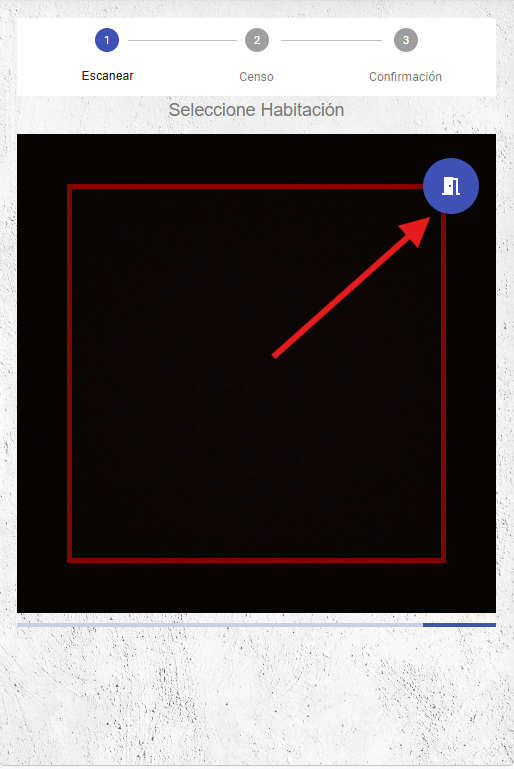

# Flujo legacy HostEast: censo QR («Mis Censos»)

## Alcance y fuentes

Documentación del flujo observado en el legacy **HostEast / SGH móvil** para censar habitaciones leyendo códigos QR. Las capturas las aporta negocio/QA; este archivo se va completando paso a paso antes de alinear la pantalla actual en NewRest_PORT.

**Ruta de acceso legacy (referencia):** módulo **Censo QR** → pantalla **Mis Censos**.

## Brecha resumida con NewRest_PORT (hoy)

| Aspecto legacy (imagen 1) | NewRest_PORT actual |
|---|---|
| Pantalla «Mis Censos» con dos listas fijas | Módulo escritorio `misCensos`: una tabla con filtro de período |
| **Censos pendientes de guardar** (lista en memoria) | Cola en `localStorage` (`sgh.censos.pendientes` / cola offline); **sin listado visible** en la pantalla |
| **Censos Registrados** del día (fecha hoy) | Misma tabla `misCensos`; opción Mid `miscensos` / `miscensosrango`; no hay bloque «solo hoy» separado |
| Botón flotante **+** → cámara QR al instante | Botón **Censo QR** en módulo Censo (escritorio); cámara tras **Usar cámara** dentro del panel (`censo-qr.js`) |
| Wizard **3 pasos** (Escanear → Censo → Confirmación) | Un solo panel con formulario (QR, fecha, turno, camas); **sin stepper** |
| Vista cámara a pantalla completa + marco de escaneo | Video embebido en el formulario, sin marco guía ni título «Seleccione Habitación» |
| Botón **puerta abierta** → selector manual de habitación | **No existe** en `censo-qr.js`; habitación solo vía JSON del QR (`qr.h`) o pegado en textarea |
| Formulario **Módulo → Piso → Tipo instalación → Habitación** (React Select) | Filtros del módulo **Censo** escritorio tienen Módulo/Piso/Habitación vía catálogo; **sin** «Tipo de instalación» ni mismo wizard |

Referencias de código actual: `SGH.Web/wwwroot/js/modulos/censo-qr.js`, `SGH.Web/wwwroot/js/core/colaOffline.js`, `SGH.Web/Pages/Censo/_ListadoMisCensos.cshtml`.

---

## Paso 1 — Pantalla inicial (ingreso al módulo)

Tras entrar al módulo de censo QR, el usuario ve la pantalla **Mis Censos** con:

### 1.1 Censos pendientes de guardar

- Lista los censos **retenidos en memoria** del dispositivo (sin persistir aún en servidor o pendientes de sincronizar).
- Permite revisar qué registros faltan subir cuando hay conexión.
- En la captura: estado vacío (**Sin resultados**).

### 1.2 Censos registrados

- Lista los censos **ya guardados en servidor** para el usuario/sesión.
- Incluye selector de **fecha** (en la captura: 23/11/2026).
- En la captura: sin filas para esa fecha (**Sin resultados**).

### 1.3 Acción principal — botón «+»

- Control circular con símbolo **+** (esquina superior derecha del contenido).
- **Abre el lector QR del dispositivo (cámara)** para iniciar un nuevo censo sin pasar por menús adicionales.

---

## Paso 2 — Escanear habitación (paso 1 del wizard)

Al pulsar **+** en la pantalla inicial, el legacy abre un flujo guiado con **indicador de pasos** en la parte superior:

| Paso | Etiqueta | Estado en captura |
|---:|---|---|
| 1 | **Escanear** | Activo (círculo resaltado) |
| 2 | **Censo** | Pendiente |
| 3 | **Confirmación** | Pendiente |

### 2.1 Título e intención

- Texto central: **«Seleccione Habitación»**.
- El área principal es el **visor de cámara** para leer el QR de la habitación (marco/rojo como zona de enfoque en la captura).

### 2.2 Escaneo por QR (camino principal)

- El usuario apunta la cámara al código QR asociado a la habitación.
- Al leer correctamente, el flujo avanza al paso **Censo** (detalle en capturas siguientes).

### 2.3 Censo manual — botón «puerta abriendo»

- Sobre el visor, botón circular con icono de **puerta abriendo** (flecha roja en la captura).
- **Acción:** abandona el modo escáner y **redirige a un listado de habitaciones disponibles** para elegir una y cargar el censo **sin QR** (ruta alternativa manual).

---

## Pasos siguientes (pendientes de capturas)

- Paso **2 Censo** (camas, turno, fecha).
- Paso **3 Confirmación** (resumen / guardar).
- Listado de habitaciones al usar el botón de puerta.
- Comportamiento offline y sincronización desde «pendientes de guardar».