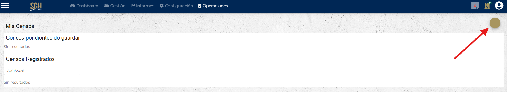

# Flujo legacy HostEast: censo QR («Mis Censos»)

## Alcance y fuentes

Documentación del flujo observado en el legacy **HostEast / SGH móvil** para censar habitaciones leyendo códigos QR. Las capturas las aporta negocio/QA; este archivo se va completando paso a paso antes de alinear la pantalla actual en NewRest_PORT.

**Ruta de acceso legacy (referencia):** módulo **Censo QR** → pantalla **Mis Censos**.

## Brecha resumida con NewRest_PORT (hoy)

| Aspecto legacy (imagen 1) | NewRest_PORT actual |
|---|---|
| Pantalla «Mis Censos» con dos listas fijas | Módulo escritorio `misCensos`: una tabla con filtro de período |
| **Censos pendientes de guardar** (lista en memoria) | Cola en `localStorage` (`sgh.censos.pendientes` / cola offline); **sin listado visible** en la pantalla |
| **Censos Registrados** del día (fecha hoy) | Misma tabla `misCensos`; opción Mid `miscensos` / `miscensosrango`; no hay bloque «solo hoy» separado |
| Botón flotante **+** → cámara QR al instante | Botón **Censo QR** en módulo Censo (escritorio); cámara tras **Usar cámara** dentro del panel (`censo-qr.js`) |

Referencias de código actual: `SGH.Web/wwwroot/js/modulos/censo-qr.js`, `SGH.Web/wwwroot/js/core/colaOffline.js`, `SGH.Web/Pages/Censo/_ListadoMisCensos.cshtml`.

---

## Paso 1 — Pantalla inicial (ingreso al módulo)

Tras entrar al módulo de censo QR, el usuario ve la pantalla **Mis Censos** con:

### 1.1 Censos pendientes de guardar

- Lista los censos **retenidos en memoria** del dispositivo (sin persistir aún en servidor o pendientes de sincronizar).
- Permite revisar qué registros faltan subir cuando hay conexión.
- En la captura: estado vacío (**Sin resultados**).

### 1.2 Censos registrados

- Lista los censos **ya guardados en servidor** para el usuario/sesión.
- Incluye selector de **fecha** (en la captura: 23/11/2026).
- En la captura: sin filas para esa fecha (**Sin resultados**).

### 1.3 Acción principal — botón «+»

- Control circular con símbolo **+** (esquina superior derecha del contenido).
- **Abre el lector QR del dispositivo (cámara)** para iniciar un nuevo censo sin pasar por menús adicionales.

---

## Pasos siguientes (pendientes de capturas)

- _(Imagen 2 en adelante: escaneo QR, formulario de camas/turno, confirmación, error offline, sincronización, etc.)_