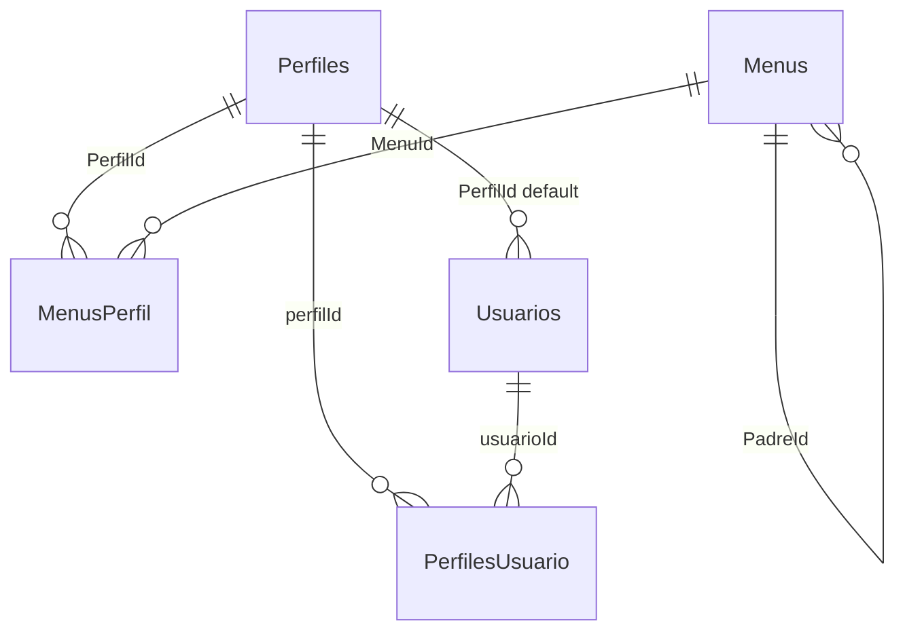

# HOTELDB — Perfiles, menú y asignaciones (extracto)

Fuente: [`Diccionario_de_datos_HotelDB.xlsx`](Diccionario_de_datos_HotelDB.xlsx) (export LocalDB, **154 tablas** catalogadas). Este extracto resume solo lo relevante para **SGH 1.5** (autorización y menú dinámico).

> En base de datos la relación menú–perfil es **`dbo.MenusPerfil`** (no existe tabla `MenuPerfil`).

---

## Modelo lógico (1.5)

- **Sesión NewRest:** el login usa **`PerfilesUsuario.id`** (asignación campamento–perfil) y el **`PerfilId`** de esa fila (`sp_Usuario_ObtenerCampamentosYPerfiles`).
- **Menú legado (datos):** cada fila de **`Menus`** es un ítem (`Link`, jerarquía `PadreId`, campo `Ubicacion`); **`MenusPerfil`** define qué ítems ve cada **`PerfilId`**.
- **Menú NewRest (UI, directriz actual):** las filas `Ubicacion = nav` son los botones de la **barra superior**; las filas `side` con `PadreId` del `nav` se muestran en el **panel desplegable** bajo ese botón (hover/click), **no** en el panel lateral `#panel-lateral` (ese panel queda para formularios de módulos).
- **Autorización HTTP (objetivo 1.5):** alinear políticas con el conjunto de `Menus.Link` (o un código derivado de `Menus.Id`) permitido para el `PerfilId` de sesión.

---

## `dbo.Perfiles`

Catálogo de perfiles del sistema.

| Columna | Tipo | Nullable | Identity | Notas |
|---------|------|----------|----------|--------|
| `Id` | int | NO | SÍ | PK |
| `Nombre` | nvarchar(100) | NO | | |
| `Descripcion` | nvarchar(400) | NO | | |
| `IsActive` | bit | NO | | |
| `MineraId` | int | SÍ | | Alcance por mandante/minera |
| `PerfilSistema` | varchar(1) | SÍ | | Flag legado |
| `PerfilGestionTI` | varchar(1) | SÍ | | Flag legado |
| `PerfilGestionAdmin` | varchar(1) | SÍ | | Flag legado |
| `VerNotificacionDesviacion` | bit | SÍ | | |
| `FechaCreacion` | datetime2 | NO | | |
| `FechaActualizacion` | datetime2 | SÍ | | |
| `UsuarioCreacionId` | int | NO | | |
| `UsuarioActualizacionId` | int | SÍ | | |

Constantes ya usadas en código (`MatrizPerfiles`): pasajero `2`, operaciones A/B `4`/`5`, IdeaUno `11`, gestión TI `68`, configuración `142`.

---

## `dbo.Menus`

Ítems de menú (árbol y metadatos de navegación).

| Columna | Tipo | Nullable | Identity | Notas |
|---------|------|----------|----------|--------|
| `Id` | int | NO | NO | Identificador del ítem (no identity en diccionario) |
| `Nombre` | nvarchar(100) | NO | | Texto visible |
| `Link` | nvarchar(200) | NO | | Ruta legado / URL destino — **clave para mapear a Razor** |
| `PadreId` | int | SÍ | | Jerarquía |
| `Ubicacion` | nvarchar(max) | NO | | Agrupación (equivalente a columnas del menú escritorio) |
| `Orden` | int | NO | | Orden dentro del grupo |
| `Icono` | nvarchar(max) | SÍ | | |
| `IsActive` | bit | NO | | |
| `FechaCreacion` | datetime2 | NO | | |
| `UsuarioCreacionId` | int | NO | | |

Tablas de respaldo en BD: `Menus_bkp20250806` (solo referencia histórica).

---

## `dbo.MenusPerfil`

Matriz **perfil → ítem de menú** (autorización de navegación en el legado).

| Columna | Tipo | Nullable | Identity |
|---------|------|----------|----------|
| `PerfilId` | int | NO | |
| `MenuId` | int | NO | FK lógica a `Menus.Id` |
| `FechaCreacion` | datetime2 | NO | |
| `UsuarioCreacionId` | int | NO | |

No hay columna `IsActive` aquí: vigencia del ítem suele venir de `Menus.IsActive` y del perfil en `Perfiles.IsActive`.

---

## `dbo.PerfilesUsuario`

Asignación usuario ↔ campamento ↔ perfil (combo del segundo paso de login).

| Columna | Tipo | Nullable | Identity |
|---------|------|----------|----------|
| `id` | int | NO | SÍ |
| `usuarioId` | int | NO | |
| `usuarioRut` | varchar(25) | SÍ | |
| `perfilId` | int | NO | |
| `campamentoId` | int | NO | |
| `empresaMandanteId` | int | NO | |
| `IsActive` | bit | NO | |
| `fechaCreacion` | datetime | NO | |
| `fechaActualizacion` | datetime | SÍ | |
| `usuarioCreacionId` | int | NO | |
| `usuarioActualizacionId` | int | SÍ | |

---

## `dbo.Usuarios` (campos ligados a perfil)

Además del login (`Password`, `Md5Retirado`, bloqueo, etc.):

| Columna | Tipo | Notas |
|---------|------|--------|
| `PerfilId` | int | Perfil por defecto en la fila de usuario |
| `EmpresaMandanteId` | int | |
| `ReservaIndividual`, `ReservaUbicaciones`, `ResponsableReserva` | bit | Reglas de negocio pasajero/reservas |

---

## Tablas relacionadas (fuera del menú principal)

| Tabla | Uso probable |
|-------|----------------|
| `CampamentosPerfilGestionAdminMinera` | Restringe campamentos visibles para perfiles de gestión admin por minera |
| `perfilesNotificacion` / `menusNotificacion` | Menús de notificaciones por perfil |
| `PoliticaUsuario` | Aceptación de políticas (login AS-IS, no menú) |

> **`dbo.Modulos`** en HOTELDB es **módulo físico del campamento** (`PabellonId`), no entrada de menú de aplicación.

---

## Muestra real — `PerfilId = 1` (administración / menú completo)

Misma jerarquía `nav` / `side`. En **Gestión** (`PadreId = 2`) aparecen los módulos migrados del escritorio:

| Nombre | `Link` | NewRest |
|--------|--------|---------|
| Solicitud | `/app/gestion/solicitud` | `/Solicitud/Datos` |
| Reserva | `/app/gestion/reserva` | `/Reserva/Datos` |
| Censo | `/app/gestion/censo` | `/Censo/Datos` |
| Solicitud Empresa | `/app/gestion/solicitudempresa` | No migrado |
| Gestión OT, etc. | … | No migrado |

En **Configuración** (`PadreId = 4`): **Usuarios** → `/app/config/usuario` → `/Cuenta/Usuarios`.

`Dashboard` (`nav` sin hijos `side`) no se muestra en el menú nuevo hasta tener página destino. **Home** con `Link = #` queda deshabilitado.

El nav **Dashboard** (`Id = 1`) suele no tener filas `side` en `MenusPerfil`; el resto de barras sí.

---

## Muestra real — `PerfilId = 137`

Estructura legado contrastada con la query `sp_Menu_ObtenerPorPerfil`:

| Nivel en BD | `Ubicacion` | `PadreId` | En pantalla NewRest |
|-------------|-------------|-----------|---------------------|
| Raíz | `nav` | `NULL` | Botón en barra superior (Gestión, Informes, …) |
| Hijo | `side` | id del `nav` | Lista dentro del **desplegable** bajo ese botón (hover/click) |

En el **sistema legado** los hijos `side` abrían un panel lateral; en **NewRest** la directriz vigente mantiene todo en la barra + desplegable (`menu-desplegable`), sin reutilizar el panel lateral para navegación.

Rutas SPA típicas: `/app/gestion`, `/app/gestion/censo`, `/app/gestion/informe/censo`, `/app/gestion/miscensos`, `/app/config/codigoqr`.

Mapeo en NewRest (`MapeoEnlacesMenu`):

| `Link` (fragmento) | Escritorio |
|--------------------|------------|
| `/app/gestion/censo` | Módulo `censo` → `/Censo/Datos` |
| `/app/gestion/miscensos` | `censoQr` (panel QR, sin página Razor) |
| `/app/gestion/informe/censo` | Sin migrar (deshabilitado) |
| Solicitud / Reserva (cuando existan en menú) | `/Solicitud/Datos`, `/Reserva/Datos` |

---

## Pendientes de inventario (actividad A1)

El diccionario **no lista procedimientos**. Para el legado hay que contrastar en código/SQL Server:

- SP o API que arma el menú para un `PerfilId` (join `Menus` + `MenusPerfil`).
- Si `Link` usa rutas SPA, hash o paths del sistema anterior y cómo mapearlas a `/Solicitud/Datos.cshtml`, etc.
- Reglas adicionales por flags en `Perfiles` (`PerfilGestionTI`, …) más allá de `MenusPerfil`.

---

## Referencias en NewRest_PORT

- Epic y actividades: [`../SGH-1.5-autorizacion-perfiles-menu-dinamico.md`](../SGH-1.5-autorizacion-perfiles-menu-dinamico.md)
- Login y `PerfilesUsuario`: [`../login-pendiente-revision-base-de-datos.md`](../login-pendiente-revision-base-de-datos.md)
- RBAC actual: [`../prompt-proyecto/autorizacion-rbac.md`](../prompt-proyecto/autorizacion-rbac.md)