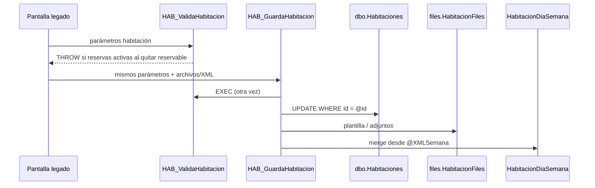

# HOTELDB — Habitaciones legado (`HAB_*`)

Referencia exportada del servidor (nov 2026). El repo **no** versiona el cuerpo completo de estos SP; este documento fija expectativas para CU-HAB.

## Flujo real (`HAB_GuardaHabitacion` + `HAB_ValidaHabitacion`)



### `HAB_ValidaHabitacion`

**No hace `INSERT`.** Solo, en edición (`@id > 0`, `@IsExistReservaConfirm = 0`):

- Si la habitación está activa y reservable, y el usuario pasa `@isReservable = 0`, comprueba `ReservasInstalacion` con `ubicacionId = @id` y `fecHorInicio >=` hora actual (truncada a hora).
- Mensaje: `Ubicacion se encuentra con reservas activas` (`THROW 50001`).

CU-HAB replica esta regla en `he_sp_habitacion_guardar` (devuelve el mismo texto en `@Mensaje`).

### `HAB_GuardaHabitacion`

| Acción | Detalle |
|--------|---------|
| Persistencia | **`UPDATE Habitaciones ... WHERE Id = @id`** — sin `INSERT`. |
| `@ret` | `@id` tras el update (con `@id = 0` no crea fila). |
| Sexo | **`SexoTabla = 11`**, **`Sexo = @sexo`** (`varchar(1)`). |
| Estado | Solo **`estado = @estado`** (no cambia `EstadoTabla` en UPDATE). |
| Archivos | `files.HabitacionFiles` / copia desde `files.PlantillaUbicacionFiles` si `@PlantillaUbicacionId > 0`. |
| Horario | `HabitacionDiaSemana` desde `@XMLSemana` (ver muestra abajo). |

**Alta:** en esta base, el **INSERT no está** en `HAB_ValidaHabitacion` ni en `HAB_GuardaHabitacion`. Puede existir en otro SP, capa intermedia o pantalla antigua distinta. **CU-HAB usa `INSERT` nativo** en `he_sp_habitacion_guardar`.

## Claves `dbo.Listas` (muestra producción)

| Columna | Valor típico |
|---------|----------------|
| `SexoTabla` | 11 |
| `Sexo` | `M` / `F` (1 carácter) |
| `EstadoTabla` | 8 (solo relevante en alta) |
| `Estado` | `D` |
| `StandardHabitacionId` | puede ser `NULL` |

FK `FK_Habitaciones_Listas_SexoTabla_Sexo`: `(SexoTabla, Sexo)` → `(Listas.IdTabla, Listas.Valor1)`.

## `HabitacionDiaSemana` (RN horaria legado)

Tabla: `HabitacionId`, `DiaNumber` (1–7), `HoraInicio`, `HoraTermino`, `IsSelected`, auditoría.

En datos reales:

- Muchas filas con `HoraInicio`/`HoraTermino` **NULL** y `IsSelected = 1` (disponible todo el día en la práctica).
- Otras con franjas (`08:00`–`20:00`, `00:00`–`23:59`, etc.).
- Hasta **7 días** por habitación; a menudo **4** días seleccionados en instalaciones faena.

**CU-HAB hoy:** flags turnos + minutos en `Habitaciones`; **no** persiste `XMLSemana` / `HabitacionDiaSemana` (pendiente RN-06).

## NewRest

| Pieza | Enfoque |
|-------|---------|
| `he_sp_habitacion_catalogo` | `IdTabla 11` sexos, `IdTabla 8` estados habitación. |
| `he_sp_habitacion_guardar` | Guardado **nativo** (sin depender de `files.HabitacionFiles`). |
| Adjuntos / semana | Fuera de alcance hasta reparar esquema `files.*` o implementar RN-06 explícito. |

## Siguiente investigación en HOTELDB (opcional)

Buscar quién hace el **INSERT** en altas históricas:

```sql
SELECT OBJECT_NAME(object_id), definition
FROM sys.sql_modules
WHERE definition LIKE N'%INSERT%Habitaciones%'
  AND OBJECTPROPERTY(object_id, 'IsProcedure') = 1;
```